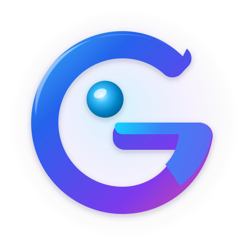

# G-Browser — Modern, Hızlı, Gizlilik Odaklı ve Tam Erişilebilir Web Tarayıcısı

<div align="center">
  <a href="https://vedatguldu.github.io/g-browser/">
    
  </a>

  <h3>G-Browser (v12.20.1)</h3>

  <p>
    <strong>Bağımsız, Sıfır Telemetrili, WCAG 2.2 AA Erişilebilir ve Yeni Nesil Masaüstü Web Tarayıcısı</strong><br>
    <em>Independent, Zero-Telemetry, WCAG 2.2 AA Accessible Next-Generation Desktop Web Browser</em>
  </p>

  <p>
    <a href="https://github.com/vedatguldu/g-browser/releases/latest/download/G-Browser-Setup-x64.exe"><strong>⬇ Windows İçin İndir (64-Bit Kurulum .exe)</strong></a>
    ・
    <a href="https://vedatguldu.github.io/g-browser/">Resmi Dokümantasyon</a>
    ・
    <a href="https://vedatguldu.github.io/g-browser/features/">Özellikler Rehberi</a>
    ・
    <a href="https://vedatguldu.github.io/g-browser/sponsor.html">Sponsor Ol & Destek Ver</a>
    ・
    <a href="https://github.com/sponsors/vedatguldu">GitHub Sponsors</a>
  </p>
</div>

---

## 🇹🇷 Türkçe Tanıtım

**G-Browser**, kullanıcı gizliliğini, yüksek performansı ve ekran okuyucu (NVDA / JAWS) erişilebilirliğini merkeze alan, **Vedat Güldü** tarafından geliştirilen bağımsız ve açık kaynaklı bir web tarayıcısıdır.

### Öne Çıkan Özellikler

- **Tam Erişilebilirlik (WCAG 2.2 AA):** Tüm araç çubuğu düğmeleri, yan panel bileşenleri, çalışma alanları ve menüler ekran okuyucularla (NVDA, JAWS, Windows Ekran Okuyucusu) tam uyumlu semantik etiketlere ve klavye kısayollarına sahiptir.
- **Çok Dilli Kurulum Sihirbazı (9 Dil):** Kurulum sihirbazı (`G-Browser-Setup-x64.exe`) işletim sistemi dilini otomatik algılar ve Türkçe, İngilizce, Almanca, Fransızca, İspanyolca, Rusça, Arapça, Japonca ve Çince dillerinde canlı dil seçimi sunar.
- **Gizlilik, Güvenlik & AdShield:** Varsayılan olarak sıfır telemetri, yerleşik izleyici/reklam engelleme (AdShield), Toplam Çerez Koruması (Total Cookie Protection), URL izleme parametresi temizleyici ve Cloudflare DNS-over-HTTPS (DoH) şifreli DNS altyapısı içerir.
- **Evrensel Medya İndirici:** Web sayfalarındaki video, ses ve yayın akışlarını otomatik algılayıp indirmeye olanak tanıyan yerleşik medya yakalayıcı.
- **Çalışma Alanları (Workspaces) & Konteyner İzolasyonu:** İş, araştırma, kişisel ve geliştirme sekmelerinizi farklı oturum konteynerleriyle birbirinden tamamen izole edin.
- **Bölünmüş Görünüm (Split View) & Yan Panel:** Tek pencerede birden fazla sekmeyi yan yana veya alt alta görüntüleyin; yer imleri, geçmiş, indirilenler, notlar ve çeviri araçlarına sabit yan panelden anında erişin.
- **Zen Modu & Özelleştirilebilir Sekme Düzeni:** Dikkat dağıtıcı tüm arayüz öğelerini tek tuşla gizleyerek yalnızca içeriğe odaklanın; dikey, çok satırlı veya kompakt sekme çubuğu düzenlerinden dilediğinizi seçin.

### Kurulum (Windows 10 / 11 — x64)

1. [**G-Browser-Setup-x64.exe İndir**](https://github.com/vedatguldu/g-browser/releases/latest/download/G-Browser-Setup-x64.exe) bağlantısından en güncel kurulum paketini indirin.
2. Kurulum sihirbazını çalıştırın, sağ üst köşeden dilediğiniz kurulum dilini seçin ve **Kur** düğmesine tıklayın.
3. Sessiz (katılımsız) kurulum için komut satırından şu komutu kullanabilirsiniz:
   ```powershell
   .\G-Browser-Setup-x64.exe /S /LANG=tr
   ```

### Projeye Sponsor Olun & Destekleyin

G-Browser tamamen bağımsızdır; hiçbir reklam ağına veya veri tüccarına bağlı değildir. Geliştirme sürecini ve sunucu altyapısını desteklemek için:

- **Çok Dilli Sponsorluk Portalı:** [https://vedatguldu.github.io/g-browser/sponsor.html](https://vedatguldu.github.io/g-browser/sponsor.html)
- **GitHub Sponsors (Uluslararası / Kredi Kartı):** [https://github.com/sponsors/vedatguldu](https://github.com/sponsors/vedatguldu)

---

## 🇬🇧 English Overview

**G-Browser** is an independent, privacy-first, and WCAG 2.2 AA accessible web browser architected and maintained by **Vedat Güldü**. Built on the Gecko engine, it combines modern power-user workflows with strict anti-tracking protections and full screen-reader accessibility.

### Key Highlights

- **First-Class Accessibility (WCAG 2.2 AA):** Every toolbar widget, sidebar panel, workspace switcher, and native menu provides clear accessible names, roles, and keyboard navigation for NVDA, JAWS, and Windows Narrator users.
- **Multi-Language Setup Wizard (9 Languages):** The native Windows installer (`G-Browser-Setup-x64.exe`) automatically detects your OS language and offers live switching across Turkish, English, German, French, Spanish, Russian, Arabic, Japanese, and Simplified Chinese.
- **Privacy, Security & AdShield:** Zero telemetry by default, built-in tracker & ad blocking (AdShield), Total Cookie Protection, URL tracking parameter stripping, and pre-configured DNS-over-HTTPS (DoH) with ECH & HTTP/3 acceleration.
- **Universal Media Downloader:** Built-in detection and downloading for video, audio, and media streams directly from the toolbar.
- **Workspaces & Container Isolation:** Organize tabs into dedicated workspaces with isolated cookie/session containers.
- **Split View & Panel Sidebar:** View multiple tabs side-by-side in a single window and access Bookmarks, History, Downloads, Notes, and web panels from the persistent sidebar.
- **Zen Mode & Flexible Tab Layouts:** Hide all toolbars and chrome for distraction-free reading, or switch between horizontal, vertical, and multi-row tab layouts.

### Installation (Windows 10 / 11 — x64)

1. Download the latest [**G-Browser-Setup-x64.exe**](https://github.com/vedatguldu/g-browser/releases/latest/download/G-Browser-Setup-x64.exe) from GitHub Releases.
2. Launch the Setup Wizard, choose your preferred language from the top-right dropdown, and click **Install**.
3. For unattended/silent installation with a specific language:
   ```powershell
   .\G-Browser-Setup-x64.exe /S /LANG=en
   ```

### Sponsor & Support G-Browser

G-Browser is 100% free, open-source, and independent. Your backing directly funds ongoing engine updates, security patches, and accessibility engineering:

- **Interactive Sponsorship Portal (TR / EN):** [https://vedatguldu.github.io/g-browser/sponsor.html](https://vedatguldu.github.io/g-browser/sponsor.html)
- **GitHub Sponsors:** [https://github.com/sponsors/vedatguldu](https://github.com/sponsors/vedatguldu)

---

## İletişim & Bağlantılar / Links & Contact

- **Geliştirici / Lead Developer:** [Vedat Güldü](https://vedatguldu.com)
- **Dokümantasyon / Documentation:** [https://vedatguldu.github.io/g-browser/](https://vedatguldu.github.io/g-browser/)
- **Hata Bildirimi / Issue Tracker:** [https://github.com/vedatguldu/g-browser/issues](https://github.com/vedatguldu/g-browser/issues)
- **Lisans / License:** Mozilla Public License 2.0 ([`LICENSE`](LICENSE))
